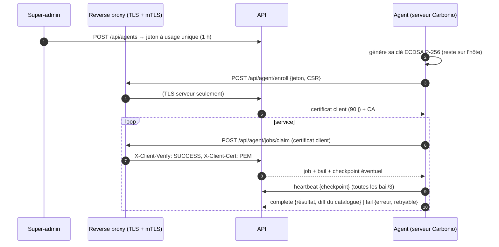

# Protocole agent ↔ API / Agent protocol

> Issue #6 (et #10 pour la reprise côté API). Implémentation : `backend/.../api/agent.py`,
> `backend/.../pki.py`, `agent/.../api_client.py`, `agent/.../worker.py`.

## Vue d'ensemble



## Sécurité

| Mesure | Détail |
|---|---|
| Clé privée de l'agent | générée **sur le serveur Carbonio**, jamais transmise. Seul le CSR circule |
| Enrôlement | jeton aléatoire de 32 octets, **à usage unique**, expiration par défaut au bout d'1 h, seul son SHA-256 est stocké, tentatives auditées |
| Certificat | ECDSA P-256 obligatoire, EKU `clientAuth`, CN `agent:<id>` imposé (le sujet du CSR est ignoré), durée 90 j (`CARBOREWIND_AGENT_CERT_DAYS`) |
| Authentification des appels | empreinte SHA-256 du certificat transmis par le proxy, puis agent `active` et certificat non expiré |
| En-têtes du proxy | acceptés **uniquement** depuis `CARBOREWIND_AGENT_PROXY_IPS`. Une requête directe portant ces en-têtes reçoit 403 |
| Révocation | `POST /api/agents/{id}/revoke` efface l'empreinte : refus immédiat |
| Connexions | toujours **sortantes** depuis l'agent : aucun port à ouvrir sur le serveur de messagerie |
| CA | `carborewind-api pki-init` : clé en `0600`, ne remplace jamais une CA existante |

### Configuration nginx (extrait)

```nginx
server {
    listen 443 ssl;
    server_name carborewind.example.org;
    ssl_certificate     /etc/ssl/carborewind/server.crt;
    ssl_certificate_key /etc/ssl/carborewind/server.key;

    # Certificat client demandé mais facultatif : l'interface web n'en a pas besoin.
    ssl_client_certificate /var/lib/carborewind/pki/ca.crt;
    ssl_verify_client optional;

    location /api/agent/ {
        # Écrase toujours les en-têtes venant du client.
        proxy_set_header X-Client-Verify $ssl_client_verify;
        proxy_set_header X-Client-Cert   $ssl_client_escaped_cert;
        proxy_pass http://api:8000;
    }
    location / {
        proxy_set_header X-Client-Verify "";
        proxy_set_header X-Client-Cert   "";
        proxy_pass http://frontend:8080;
    }
}
```

L'enrôlement passe par `/api/agent/enroll` **sans** certificat client (`ssl_verify_client optional`).
Les autres routes `/api/agent/*` exigent `X-Client-Verify: SUCCESS`.

## Jobs : bail, reprise et idempotence

| Situation | Comportement |
|---|---|
| `claim` | `SELECT … FOR UPDATE SKIP LOCKED` : un job n'est jamais pris deux fois. Un job abandonné (bail expiré) passe **avant** les jobs en attente |
| Premier `claim` d'une sauvegarde | `snapshot_id` et `seq` sont fixés et conservés dans le job, pour qu'une reprise écrive le **même** snapshot |
| `heartbeat` | prolonge le bail (5 min par défaut) et enregistre le **checkpoint** de l'agent |
| Agent mort | à l'expiration du bail, le job est repris par un agent avec son checkpoint (tentative + 1). Au-delà de `max_attempts` (3), il passe en `failed` |
| `fail` retryable | remis en file en gardant son checkpoint. Non retryable (compte inconnu, droits refusés) : `failed` |
| `complete` reçu deux fois | idempotent : la réponse a pu être perdue, aucun doublon n'est créé |
| `complete` | dans **une seule transaction** : snapshot, blobs, fermeture des versions remplacées ou supprimées, ouverture des nouvelles, dossiers, job `succeeded`, audit `backup.complete` |

### Jobs `migrate` (migration IMAP)

| Étape | Comportement |
|---|---|
| `claim` | la réponse contient `migration` : `imap` (hôte, port, TLS, identifiants **déchiffrés à cet instant**), `options`, `state` (état incrémental), `dry_run`. Les identifiants ne sont jamais écrits dans le job. Mot de passe absent ou indéchiffrable : job `failed` sans être transmis. |
| `heartbeat` | `progress` (dossier, dossiers faits, messages copiés) ; `409` si le lot a été arrêté → l'agent s'arrête au message suivant |
| `migrate-complete` | `{dry_run, cancelled, copied, duplicates, bytes, failed, failed_count, folders[], state}` ; accepté aussi sur un job annulé pour conserver l'état ; idempotent |

Voir [migrations.md](migrations.md).

## Commandes

```bash
# Serveur CarboRewind
docker compose run --rm api carborewind-api pki-init
# Interface ou API : créer l'agent → récupérer le jeton

# Serveur Carbonio
sudo -u carborewind carborewind-agent enroll --token-file /root/agent.token \
     --server-ca /etc/carborewind/server-ca.crt
sudo systemctl enable --now carborewind-agent   # carborewind-agent run
```
