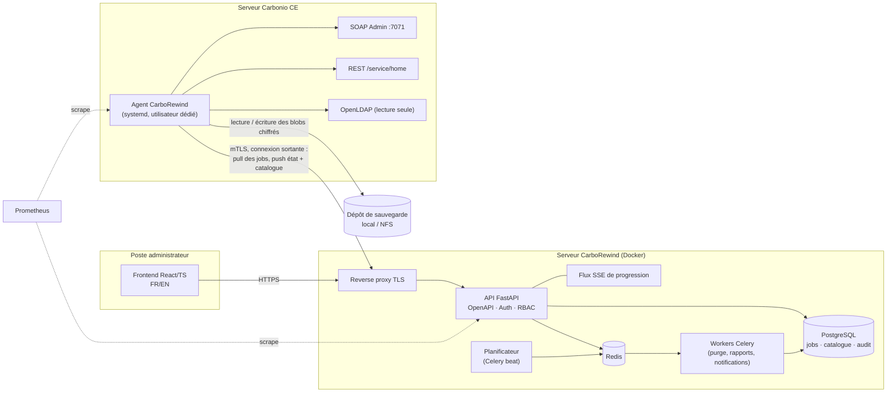
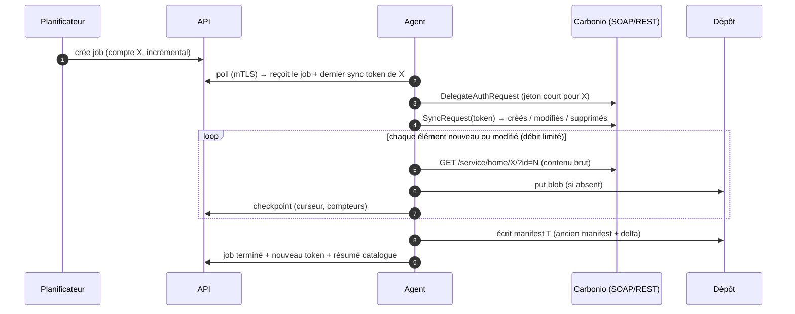

# Architecture de CarboRewind

> Statut : **proposition validée pour le MVP** (M0). Les éléments marqués 🔎 sont des
> **hypothèses à vérifier** sur la version exacte de Carbonio CE ciblée avant implémentation.

## 1. Contexte et hypothèses

| Élément | Valeur retenue |
|---|---|
| Édition | Carbonio **CE** d'abord ; Advanced (module Backup natif) après le MVP |
| Topologie | Mono-serveur, Ubuntu 22.04 |
| Volumétrie | 500 – 5 000 comptes, 1 – 10 To |
| Stockage des sauvegardes | Disque local ou montage NFS (S3 / SFTP en v0.2+) |
| Pile | Python 3.12 · FastAPI · PostgreSQL 16 · Celery + Redis · React + TypeScript |

## 2. Vue des composants



### Principes

1. **Séparation plan de contrôle / plan de données.** Les données des boîtes aux lettres ne
   transitent jamais par l'API : l'agent lit Carbonio localement et écrit directement dans le
   dépôt. L'API ne stocke que métadonnées, catalogue et audit.
2. **Agent en connexion sortante uniquement** (long-polling HTTPS en mTLS vers l'API) : aucun
   port supplémentaire ouvert sur le serveur de messagerie.
3. **Interface `BackupProvider`** : `CarbonioCEProvider` (MVP) puis `CarbonioAdvancedProvider`,
   pour que le reste du système ignore l'édition.
4. **Aucune commande shell construite à partir d'une donnée utilisateur** : intégrations via
   SOAP/REST/LDAP en bibliothèques ; tout sous-processus éventuel a une liste d'arguments fixe.

## 3. Format du dépôt de sauvegarde

Inspiré de restic/borg : **stockage adressé par contenu, dédupliqué, chiffré**.

```
repository/
├── config.json            # version du format, paramètres KDF, identifiant du dépôt
├── keys/                  # clé maître chiffrée (enveloppe) — jamais en clair
├── blobs/ab/abcdef…       # objets : zstd puis AES-256-GCM, nom = SHA-256 du clair (HMAC)
├── manifests/<account>/<snapshot-id>.json.enc
└── locks/
```

- **Objet (blob)** : contenu d'un élément (`.eml` brut, `.ics`, `.vcf`, document) ou de ses
  métadonnées (dossier, tags, drapeaux, dates). Identifiant = HMAC-SHA-256 (clé dérivée) du
  clair, pour dédupliquer sans révéler le contenu.
- **Manifest** : état complet d'une boîte à l'instant T (arborescence des dossiers + liste
  `item → blob`). Une sauvegarde incrémentale ne copie que les nouveaux blobs, mais produit un
  manifest complet : **toute sauvegarde est restaurable seule** (point-in-time exact, y compris
  les suppressions).
- **Chiffrement** : AES-256-GCM, nonce aléatoire de 96 bits par objet ; clé maître chiffrée par
  une clé d'enveloppe fournie via variable d'environnement / fichier monté / KMS. Rotation : on
  ré-enveloppe la clé maître (pas de ré-chiffrement des données).
- **Intégrité** : vérification GCM à chaque lecture + commande `verify` (lecture d'un échantillon
  ou de la totalité, planifiable).
- **Rétention / purge** : suppression des manifests expirés puis ramasse-miettes des blobs non
  référencés (marquage depuis le catalogue PostgreSQL, sous verrou exclusif).
- **Idempotence** : écrire un blob déjà présent est un no-op ; écriture atomique
  (fichier temporaire + `rename`).

## 4. Flux principaux

### 4.1 Sauvegarde incrémentale d'un compte



### 4.2 Reprise d'un job interrompu

Le job conserve un **checkpoint** (dernier élément traité, liste des blobs écrits). Au
redémarrage, l'agent récupère le job en état `running` dont le bail (*lease*) a expiré et repart
du checkpoint ; les blobs déjà écrits sont ignorés grâce à l'adressage par contenu. Le
`SyncRequest` n'est validé (nouveau token stocké) qu'à la fin, quand le manifest est écrit.

### 4.3 Restauration granulaire d'un mail

1. L'utilisateur parcourt un snapshot (catalogue PostgreSQL : dossiers, sujet, expéditeur, date).
2. Il choisit le mode : *fusionner* (défaut), *écraser*, ou *autre compte / dossier dédié*
   (`/Restauré-AAAA-MM-JJ`).
3. Un **dry-run** est calculé (ce qui serait créé / remplacé / ignoré).
4. L'agent lit le blob, puis `AddMsgRequest` avec dossier, drapeaux et tags d'origine.
5. L'action est inscrite dans l'audit (qui, quoi, quand, source, cible, résultat).

## 5. Intégration Carbonio CE

| Besoin | Mécanisme | Limites / remarques |
|---|---|---|
| Inventaire | SOAP Admin `GetAllAccountsRequest`, `GetAccountRequest`, `GetMailboxRequest`, `GetAllDomainsRequest`, `GetAllCosRequest` 🔎 | Compte de service administrateur global en CE (délégation fine limitée) → **privilège élevé** : compte dédié, accès localhost uniquement, secret en rotation, audit côté Carbonio |
| Accès à une boîte | `DelegateAuthRequest` (jeton de courte durée) 🔎 | Tracé dans les journaux Carbonio |
| Détection des changements | `SyncRequest` avec token (créations, modifications, **suppressions**) 🔎 | Token expiré ou invalidé → sauvegarde complète du compte |
| Lecture du contenu | REST `GET /service/home/<compte>/?id=<n>` ; `?fmt=ics` / `?fmt=vcf` par dossier ; `?fmt=tgz` pour une complète de contrôle 🔎 | `tgz` coûteux en E/S : fenêtres horaires + throttling |
| Restauration | `CreateFolderRequest`, `AddMsgRequest`, `CreateContactRequest`, `CreateAppointmentRequest` / import ics ; compte complet : REST `POST ?fmt=tgz&resolve=skip\|replace\|reset` 🔎 | Les identifiants changent après restauration ; partages / ACL réappliqués séparément |
| Configuration | `ldapsearch` (DN de service en lecture seule) + SOAP (domaines, COS, listes de distribution, alias, quotas) 🔎 | Certificats et clés privées : chiffrés séparément, réservés au super-admin |
| Compte supprimé | `CreateAccountRequest` à partir des attributs sauvegardés, puis rejeu du manifest | Mot de passe d'origine non restaurable si le hash n'est pas exporté |

**Carbonio Advanced (post-MVP)** : piloter le module Backup natif (SmartScan, Real Time Scan,
restauration granulaire) via ses commandes / API 🔎 derrière la même interface `BackupProvider`.

## 6. Sécurité

| Menace | Mesure |
|---|---|
| Vol des sauvegardes | Chiffrement AES-256-GCM au repos ; clé d'enveloppe hors du dépôt ; noms de blobs HMAC |
| Usurpation de l'agent | mTLS avec certificat client par agent, révocable ; enrôlement par jeton à usage unique |
| Abus de privilèges | RBAC (super-admin, admin de domaine, opérateur restauration, lecteur) ; périmètre par domaine contrôlé côté API |
| Restauration malveillante / erreur | Dry-run, confirmation explicite pour *écraser*, snapshot de sécurité avant écrasement, audit |
| Altération de l'audit | Journal append-only, chaînage par hash (chaque entrée contient le hash de la précédente), export signé |
| Injection | Validation Pydantic stricte, ORM paramétré, aucune commande shell construite à partir d'entrées |
| Web | HTTPS obligatoire, HSTS, CSP, cookies `Secure; HttpOnly; SameSite=Strict`, CSRF (double submit), rate limiting |
| Chaîne logicielle | CodeQL, dependency review, Dependabot, gitleaks, images non-root, SBOM et provenance |

### RGPD

- Traçabilité : audit de chaque accès et restauration.
- Durées de rétention configurables, purge automatique.
- **Droit à l'effacement** : grâce au catalogue, retrait d'un compte / d'éléments de tous les
  manifests puis ramasse-miettes des blobs devenus orphelins (procédure documentée en M5).

## 7. Non fonctionnel

- **Impact minimal** : concurrence plafonnée (`max_concurrent_accounts`), limite de débit,
  fenêtres horaires, recul automatique si la charge système dépasse un seuil.
- **Observabilité** : journaux JSON, métriques Prometheus (`/metrics` API et agent).
- **Qualité** : typage strict (mypy, TypeScript strict), couverture ≥ 80 % imposée en CI.

## 8. Risques principaux

| Risque | Impact | Mitigation |
|---|---|---|
| Perte de la clé de chiffrement | Sauvegardes illisibles | Séquestre de la clé (procédure PRA), test de déchiffrement périodique |
| Mode *écraser* mal utilisé | Perte de données | Dry-run, confirmation, snapshot de sécurité préalable |
| Charge sur le mailstore | Dégradation du service | Throttling, fenêtres, incrémentales via `SyncRequest` |
| Divergence d'API entre versions CE | Échecs de sauvegarde | Tests de contrat, matrice de compatibilité, hypothèses 🔎 vérifiées par version |
| Fidélité incomplète (partages, règles, signatures) | Restauration partielle | Sauvegarde des préférences et ACL comme métadonnées ; limites documentées |
