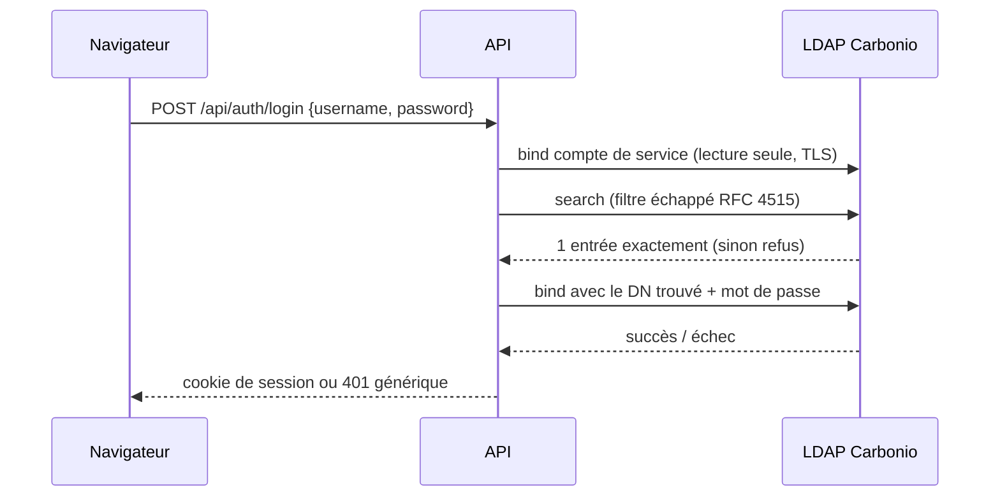

# Authentification / Authentication

> Portée : issue #3. Le contrôle d'accès par rôle (RBAC) est traité dans #4, l'OIDC/SAML et
> le MFA en v0.2. Les éléments marqués 🔎 sont des hypothèses à vérifier sur la version
> Carbonio CE ciblée.

## Sources d'identité

| Source | Usage | Stockage |
|---|---|---|
| **Locale** | Premier super-admin (*bootstrap*) et comptes de secours | Hash **Argon2id** (64 MiB, t=3, p=4), ré-haché automatiquement si les paramètres évoluent |
| **LDAP Carbonio** | Administrateurs Carbonio existants | Aucun mot de passe stocké. Le compte est créé au premier login, **sans rôle** |

Politique de mot de passe local (NIST SP 800-63B) : au moins 12 caractères et au plus 1024, sans règle de
composition.

### Créer le premier super-admin

```bash
docker compose run --rm api carborewind-api create-user admin --role super_admin
# le mot de passe est demandé au terminal (ou lu sur stdin), jamais passé en argument
```

### Flux LDAP



- **Transport chiffré obligatoire** : `ldaps://` ou `ldap://` avec `CARBOREWIND_LDAP_START_TLS=true`.
  Le certificat est vérifié (`CERT_REQUIRED`, CA configurable via `CARBOREWIND_LDAP_CA_FILE`).
- **Injection LDAP** : le login est échappé (`escape_filter_chars`) avant d'être inséré dans le filtre.
- **Mot de passe vide refusé** avant tout bind. Un bind simple sans mot de passe réussit en
  « non authentifié » (RFC 4513 §5.1.2).
- **Filtre par défaut** 🔎 :
  `(&(objectClass=zimbraAccount)(zimbraIsAdminAccount=TRUE)(zimbraAccountStatus=active)(|(uid={username})(mail={username})))`.
  Il est configurable via `CARBOREWIND_LDAP_USER_FILTER`.
- **Compte de service** 🔎 : un DN en lecture seule sur la branche des comptes. Sur Carbonio CE,
  il faut vérifier quel compte système (`cn=appaccts`…) ou quel DN dédié utiliser, avec quelles ACL.
  La procédure sera détaillée dans le guide d'installation (#19).
- Un utilisateur LDAP **n'a aucun accès** tant qu'un super-admin ne lui a pas attribué de rôle.
  Il reçoit alors un 401, et la raison `no_role` est inscrite dans l'audit.

## Sessions

| Propriété | Valeur |
|---|---|
| Jeton | 32 octets aléatoires (`secrets.token_urlsafe`). Seul son **SHA-256** est stocké en base |
| Cookie | `__Host-carborewind_session` : `Secure; HttpOnly; SameSite=Strict; Path=/` |
| Inactivité | 30 min (`CARBOREWIND_SESSION_IDLE_MINUTES`) |
| Durée absolue | 12 h (`CARBOREWIND_SESSION_ABSOLUTE_HOURS`) |
| Déconnexion | révocation côté serveur (`revoked_at`) et suppression des cookies |

Le préfixe `__Host-` impose HTTPS, l'absence d'attribut `Domain` et `Path=/`, ce qui protège
contre le *cookie tossing* depuis un sous-domaine.

## CSRF

- **Double submit** : à la connexion, un jeton CSRF lié à la session est renvoyé dans le corps
  de la réponse et dans le cookie lisible `__Host-carborewind_csrf`. Toute requête non sûre
  (POST, PUT, PATCH, DELETE) doit le renvoyer dans l'en-tête `X-CSRF-Token`. La comparaison se fait
  en temps constant.
- **CSRF de connexion** : `/api/auth/login` n'accepte que `application/json`. Un formulaire HTML
  intersite ne peut pas envoyer ce type sans pré-requête CORS, que l'API refuse par défaut.
- Défense en profondeur : `SameSite=Strict` sur les cookies.

## Protection contre la force brute

| Mécanisme | Défaut | Variable |
|---|---|---|
| Limite par adresse IP | 20 tentatives / 5 min (fenêtre fixe, Redis) | `CARBOREWIND_LOGIN_IP_LIMIT`, `CARBOREWIND_LOGIN_IP_WINDOW_SECONDS` |
| Verrouillage du compte | après 5 échecs, durée 1, 2, 4, 8… min (plafond 24 h) | `CARBOREWIND_LOGIN_MAX_FAILURES`, `CARBOREWIND_LOGIN_LOCK_BASE_MINUTES` |
| Énumération | réponse **identique** (401 `invalid credentials`) pour un utilisateur inconnu, un mauvais mot de passe, un compte verrouillé, inactif ou sans rôle. Un Argon2 factice est exécuté pour égaliser le temps de réponse | — |

Sans Redis (développement), le limiteur est en mémoire, propre à chaque processus.

## Audit

Chaque tentative est inscrite dans `audit_events`, chaînée par hash, avec action, résultat et IP :

| Action | Résultat | `details.reason` |
|---|---|---|
| `auth.login` | `success` | `auth_source` |
| `auth.login` | `failure` | `bad_credentials` |
| `auth.login` | `denied` | `locked`, `inactive`, `no_role`, `rate_limited` |
| `auth.logout` | `success` | — |
| `user.create` (CLI) | `success` | `username`, `role` |

## API

| Méthode | Chemin | Auth | CSRF |
|---|---|---|---|
| POST | `/api/auth/login` | — | JSON uniquement |
| POST | `/api/auth/logout` | session | `X-CSRF-Token` |
| GET | `/api/auth/me` | session | — |

Le détail des schémas est dans OpenAPI : `/api/docs`.
