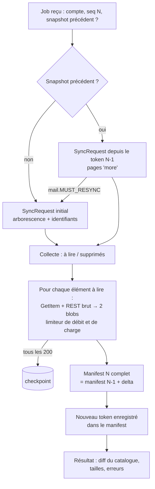

# Moteur de sauvegarde / Backup engine

> Issues #9 et #10. Implémentation : `agent/src/carborewind_agent/backup.py` et `throttle.py`.

## Déroulement d'une sauvegarde de compte

| Propriété | Comment |
|---|---|
| **À chaud** | uniquement des lectures API ; aucun arrêt ni verrou côté Carbonio |
| **Point-in-time** | chaque manifest est **complet**. Restaurer le snapshot N ne demande pas de rejouer une chaîne, et les suppressions sont respectées |
| **Incrémental réel** | seuls les éléments modifiés sont relus. Les blobs inchangés sont réutilisés, et un changement de drapeau ne recrée que le petit blob de métadonnées |
| **Token sûr** | le nouveau token n'est enregistré qu'une fois **tous** les éléments stockés : une interruption ne fait jamais sauter de changement |
| **`MUST_RESYNC`** | bascule automatique en complète. Le diff du catalogue reste calculé par rapport au snapshot précédent |
| **Reprise** (#10) | un checkpoint toutes les 200 lectures. Au redémarrage, les éléments déjà stockés sont sautés, sans les relire dans Carbonio |
| **Idempotence** | blobs adressés par contenu et manifest réécrit atomiquement : rejouer un job ne crée aucun doublon |
| **Erreur sur un élément** | le snapshot est marqué **partiel**, l'erreur est consignée dans le manifest, et la version précédente de l'élément est **conservée** |
| **Élément supprimé pendant la lecture** | ignoré (`mail.NO_SUCH_ITEM`) ; il sera vu comme supprimé à la prochaine synchronisation |

## Impact sur le serveur de messagerie

| Réglage | Défaut | Variable |
|---|---|---|
| Débit maximal de lecture | illimité | `CARBOREWIND_AGENT_MAX_BANDWIDTH_MBPS` |
| Pause si la charge système est élevée | load average 1 min / CPU > 1,5 (attente au plus 5 min par lecture) | `CARBOREWIND_AGENT_MAX_LOAD_PER_CPU` (0 = désactivé) |
| Comptes en parallèle | 2 | `CARBOREWIND_AGENT_MAX_CONCURRENT_ACCOUNTS` |
| Taille des pages `SyncRequest` | 500 | — |

Les fenêtres horaires sont gérées par la planification (#16).

## Métadonnées extraites pour le catalogue

Sujet, expéditeur et date (en-têtes RFC 5322) pour les mails ; `FN` pour les contacts ; date
Carbonio en repli. Ces champs alimentent la recherche (#11). Le contenu, lui, reste dans les blobs chiffrés.

## Limites connues (CE)

- **Contenu des contacts, rendez-vous et tâches** lu par REST `?id=` 🔎. Le format exact (vcf, ics)
  renvoyé pour ces types est à confirmer avec `carbonio probe`.
- **Partages et ACL de dossiers** : conservés dans les métadonnées du dossier quand `SyncRequest` les
  expose 🔎. Leur réapplication relève de la restauration (#12).
