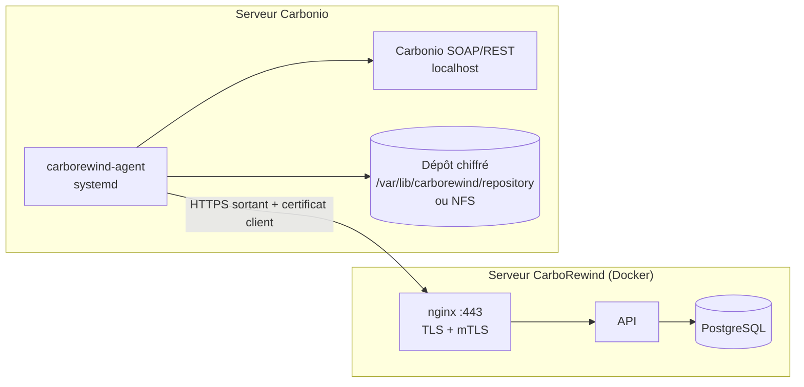

# Installation de CarboRewind

> Version : **0.1.0~dev** (pré-version du MVP). Lisez la section **Limites de cette version**
> avant de l'utiliser sur des données réelles.

CarboRewind se compose de deux parties :

| Composant | Où | Livrable |
|---|---|---|
| **Serveur** : API, base PostgreSQL, Redis, interface web, reverse proxy TLS/mTLS | une VM ou un serveur dédié (Docker) | `carborewind-server-<version>.tar.gz` |
| **Agent** : lit Carbonio et écrit le dépôt de sauvegarde chiffré | **le serveur Carbonio** (Ubuntu 22.04) | `carborewind-agent_<version>_amd64.deb` |



L'agent n'ouvre **aucun port** sur le serveur Carbonio : il initie toutes les connexions.

---

## 1. Prérequis

**Serveur CarboRewind**
- Linux x86_64 avec Docker Engine 24 ou plus récent et le plugin Docker Compose v2, `openssl`, `curl`.
- 2 vCPU, 4 Go de RAM, 20 Go de disque pour la base. Les sauvegardes elles-mêmes sont stockées côté Carbonio.
- Un nom DNS, par exemple `carborewind.example.org`, et idéalement un certificat TLS valide. À défaut,
  un certificat auto-signé est généré.
- Accès Internet pendant l'installation (images Docker, paquets Python et npm).
- Ports entrants 443 (et 80 pour la redirection) ouverts depuis le serveur Carbonio et les postes d'administration.

**Serveur Carbonio**
- Ubuntu 22.04 x86_64 (ou plus récent), Carbonio CE. Le paquet embarque son propre Python 3.12 : rien
  d'autre à installer.
- Accès HTTPS sortant vers le serveur CarboRewind.
- Un emplacement pour le dépôt de sauvegarde : disque local ou montage **NFSv4**, d'une taille d'environ 1,2 fois
  le volume des boîtes au départ. La compression et la déduplication réduisent ensuite fortement la croissance.

## 2. Installer le serveur

```bash
tar xzf carborewind-server-<version>.tar.gz
cd carborewind-server-<version>
sudo ./deploy/install-server.sh --server-name carborewind.example.org \
     --tls-cert /chemin/fullchain.pem --tls-key /chemin/privkey.pem
# sans --tls-cert/--tls-key : certificat auto-signé généré dans /opt/carborewind/deploy/tls/
```

Le script :
1. copie l'application dans `/opt/carborewind` ;
2. génère les secrets dans `/opt/carborewind/deploy/.env` (mode `0600`). **Sauvegardez ce fichier.** Les
   secrets existants ne sont jamais écrasés ;
3. construit les images, démarre PostgreSQL et Redis et applique les migrations ;
4. crée l'**autorité de certification des agents**, dans le volume `pki`, sans jamais écraser une CA existante ;
5. démarre la pile et vérifie `https://<nom>/readyz`.

Le script est **idempotent** : le relancer après une mise à jour reconstruit les images et applique les nouvelles migrations.

Créez ensuite le premier super-administrateur. Le mot de passe est demandé au clavier ; il doit
faire au moins 12 caractères :

```bash
cd /opt/carborewind/deploy
sudo docker compose -f docker-compose.prod.yml run --rm api carborewind-api create-user admin
```

Mot de passe oublié ou compte verrouillé ? Réinitialisez-le (le compte est déverrouillé et ses
sessions ouvertes sont fermées) :

```bash
sudo docker compose -f docker-compose.prod.yml run --rm api carborewind-api set-password admin
```

Puis enregistrez l'agent du serveur Carbonio. La commande affiche un **jeton à usage unique**, valable 1 h :

```bash
sudo docker compose -f docker-compose.prod.yml run --rm api \
     carborewind-api agent-create mx1 mail.example.org
```

## 3. Préparer Carbonio

Sur le serveur Carbonio, en tant qu'utilisateur `zextras` :

```bash
# Compte administrateur dédié à CarboRewind (jamais le compte « admin » principal)
carbonio prov createAccount carborewind@example.org '<mot-de-passe-long>' zimbraIsAdminAccount TRUE
```

🔎 En Carbonio CE, la délégation fine des droits d'administration est limitée. Un compte
administrateur est nécessaire pour `DelegateAuthRequest`. Il est réservé à CarboRewind et n'est utilisé que
depuis `localhost`.

## 4. Installer l'agent (serveur Carbonio)

```bash
sudo apt install ./carborewind-agent_<version>_amd64.deb
```

Le paquet crée l'utilisateur système `carborewind`, les répertoires `/etc/carborewind` (`0750`) et
`/var/lib/carborewind` (`0700`), l'unité systemd durcie `carborewind-agent.service` (non démarrée), et
la commande `carborewind-agent`. Lancée par root, cette commande se ré-exécute automatiquement sous
l'utilisateur `carborewind`.

### 4.1 Configuration

```bash
sudo nano /etc/carborewind/agent.env      # URL de l'API, compte Carbonio, chemins
```

Les secrets vont dans des **fichiers `0600`**, jamais dans `agent.env` :

```bash
# Mot de passe du compte Carbonio créé à l'étape 3
sudo install -o carborewind -g carborewind -m 0600 /dev/null /etc/carborewind/carbonio-admin.password
sudo nano /etc/carborewind/carbonio-admin.password

# Certificat HTTPS du serveur CarboRewind s'il est auto-signé (copié depuis
# /opt/carborewind/deploy/tls/server.crt), puis décommenter CARBOREWIND_AGENT_API_CA_FILE
sudo install -m 0644 server.crt /etc/carborewind/api-ca.crt
```

Si le certificat de Carbonio est auto-signé, renseignez `CARBOREWIND_AGENT_CARBONIO_CA_FILE`. La
vérification TLS n'est jamais désactivée.

### 4.2 Dépôt de sauvegarde et clé de chiffrement

```bash
sudo carborewind-agent repo keygen    # crée /etc/carborewind/repository.key (0600)
sudo carborewind-agent repo init      # crée le dépôt chiffré
```

> ⚠️ **Sans cette clé, les sauvegardes sont irrécupérables.** Copiez immédiatement le contenu de
> `/etc/carborewind/repository.key` dans **deux** emplacements hors du serveur Carbonio, par exemple un coffre de mots
> de passe d'équipe et un coffre physique. Voir `docs/repository.md`.

Pour un dépôt sur NFS : montez le partage (NFSv4, `hard`) sur `/var/lib/carborewind/repository`
**avant** `repo init`, avec des droits d'écriture pour l'utilisateur `carborewind`.

### 4.3 Vérifier l'accès à Carbonio (lecture seule)

```bash
sudo carborewind-agent check-config
sudo carborewind-agent carbonio probe --account un.compte.de.test@example.org
```

Chaque étape doit afficher ✓. **Transmettez la sortie à l'équipe de développement.** Elle valide les
hypothèses d'API faites sur votre version de Carbonio (voir `docs/carbonio-integration.md`).
N'allez pas plus loin si une ligne affiche ✗.

### 4.4 Enrôlement et démarrage

```bash
echo '<jeton affiché par agent-create>' | sudo carborewind-agent enroll
sudo systemctl enable --now carborewind-agent
sudo journalctl -u carborewind-agent -f
```

L'agent génère sa clé privée **localement**, obtient son certificat client (90 jours), synchronise
l'inventaire des comptes, puis attend des travaux.

## 5. Première sauvegarde

Depuis le serveur CarboRewind :

```bash
cd /opt/carborewind/deploy
sudo docker compose -f docker-compose.prod.yml run --rm api carborewind-api backup un.compte.de.test@example.org --full
```

Suivez son exécution dans `journalctl -u carborewind-agent -f` sur le serveur Carbonio. Pour
vérifier le dépôt :

```bash
sudo carborewind-agent repo verify --sample 0.1
```

Et l'intégrité du journal d'audit :

```bash
sudo docker compose -f docker-compose.prod.yml run --rm api carborewind-api audit-verify
```

## 6. Exploitation courante

| Action | Commande |
|---|---|
| État des services serveur | `docker compose -f docker-compose.prod.yml ps` |
| Journaux serveur | `docker compose -f docker-compose.prod.yml logs -f api proxy` |
| Journaux agent | `journalctl -u carborewind-agent` |
| Mise à jour du serveur | extraire la nouvelle archive puis relancer `install-server.sh` |
| Mise à jour de l'agent | `sudo apt install ./carborewind-agent_<nouvelle>_amd64.deb` (la configuration `agent.env` est conservée) |
| Sauvegarde de la base CarboRewind | `docker compose -f docker-compose.prod.yml exec db pg_dump -U carborewind carborewind > carborewind.sql` |
| Révoquer un agent | API `POST /api/agents/{id}/revoke` (super-admin) |

**À sauvegarder hors site** : `/opt/carborewind/deploy/.env`, le volume Docker `carborewind_pki`
(la CA des agents), un dump de la base, la clé `/etc/carborewind/repository.key`, et le dépôt lui-même
(réplication prévue en v0.2).

## 7. Désinstallation

```bash
# Agent : le dépôt, la clé et les certificats sont CONSERVÉS volontairement
sudo apt remove carborewind-agent        # ou purge : /etc et /var/lib/carborewind restent

# Serveur : arrêt sans perte de données
cd /opt/carborewind/deploy && sudo docker compose -f docker-compose.prod.yml down
# (« down -v » supprimerait la base et la CA : uniquement si vous voulez tout effacer)
```

## 8. Limites de cette version

Cette pré-version installe le **socle de sauvegarde** (jalons M0 à M2) :

- ✅ Sauvegarde **complète et incrémentale à chaud** d'un compte, dans un dépôt **chiffré** et dédupliqué,
  avec catalogue point-in-time, reprise des jobs interrompus et audit complet.
- ❌ **Pas encore de restauration** (jalon M3) : les données sont sauvegardées et vérifiables, mais leur
  remise dans Carbonio arrive dans la prochaine version.
- ✅ **Interface web** (`https://<nom>/`) : connexion (compte local ou LDAP), tableau de bord, liste des
  comptes par domaine avec date de dernière sauvegarde, bouton « Sauvegarder maintenant »
  (incrémentale / complète), suivi des jobs et historique des snapshots d'un compte, en FR/EN.
  Les boutons de sauvegarde ne s'affichent que pour les super-admins et les admins du domaine.
- ❌ Pas encore de planification automatique (M5) : les sauvegardes se lancent depuis l'interface ou avec
  `carborewind-api backup`.
- 🔎 Exécutez `carbonio probe` (§ 4.3) avant toute sauvegarde de données de production.
- Le paquet `.deb` cible Ubuntu/Debian (amd64). Le Python embarqué fonctionne sur toute distribution à
  glibc 2.17 ou plus récente, mais aucun paquet RPM n'est encore fourni.
