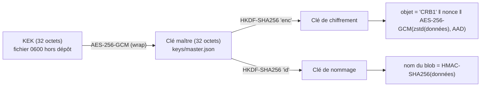

# Dépôt de sauvegarde / Backup repository

> Issue #8. Implémentation : `agent/src/carborewind_agent/repository/`.
> Stockage cible du MVP : disque local ou montage NFS sur le serveur Carbonio.

## Arborescence

```
<racine>/
├── config.json                       version du format, identifiant (aucun secret)
├── keys/master.json                  clé maître chiffrée par la KEK
├── blobs/ab/abcdef…(64 hex)          objets scellés, adressés par contenu
├── manifests/<compte>/<snapshot>.json  manifests scellés
└── locks/repo.lock                   verrou consultatif
```

Tous les répertoires sont en `0700` et les fichiers en `0600` ; seul `config.json` est en `0644`.

## Cryptographie



| Propriété | Mécanisme |
|---|---|
| Confidentialité | AES-256-GCM avec un nonce aléatoire de 96 bits par objet ; compression zstd **avant** chiffrement |
| Intégrité et authenticité | tag GCM. Le nom du blob est en plus recalculé à la lecture |
| Anti-substitution | l'AAD contient l'identifiant du blob (ou le chemin du manifest) : un fichier copié à la place d'un autre est rejeté |
| Déduplication | nom = HMAC(clé de nommage, contenu) : même contenu, même nom. **Clé propre au dépôt** : un nom ne révèle pas un hash connu |
| Rotation de la KEK | `carborewind-agent repo rotate-key` re-chiffre la seule clé maître, sans toucher aux données |

> Limite : la rotation de la **clé maître** elle-même (re-chiffrement complet) n'est pas prévue
> dans le MVP. En cas de compromission de la clé maître, il faut créer un nouveau dépôt et refaire
> une sauvegarde complète.

## Robustesse

- **Écriture atomique** : fichier temporaire dans le même répertoire, `fsync`, `rename`, puis `fsync` du
  répertoire. Un crash ne laisse jamais de blob partiel sous son nom définitif.
- **Idempotence** : réécrire un blob existant ne fait rien. Une sauvegarde interrompue reprend sans
  doublon (#10).
- **Verrous** : partagé pour les sauvegardes et restaurations (concurrentes), exclusif pour la purge.
  `flock` sur NFS exige **NFSv4**, ou NFSv3 avec `lockd`.
- **Vérification** : `carborewind-agent repo verify [--sample 0.1]` déchiffre et authentifie tous les
  blobs ou un échantillon. Code de sortie 3 en cas de corruption, ce qui permet de le planifier.

## Commandes

```bash
sudo -u carborewind carborewind-agent repo keygen       # crée /etc/carborewind/repository.key (0600)
sudo -u carborewind carborewind-agent repo init
sudo -u carborewind carborewind-agent repo verify --sample 0.05
sudo -u carborewind carborewind-agent repo rotate-key /etc/carborewind/repository.key.new
```

Chemins par défaut, modifiables par `--path` / `--key-file` ou par les variables
`CARBOREWIND_AGENT_REPOSITORY_PATH` / `CARBOREWIND_AGENT_REPOSITORY_KEY_FILE`.

## ⚠️ Séquestre de la clé (à lire avant la première sauvegarde)

**Sans la KEK, les sauvegardes sont irrécupérables.** C'est voulu, mais c'est aussi le premier
risque de perte de données.

1. Juste après `repo keygen`, copiez le contenu de la clé dans **deux** emplacements hors du serveur
   Carbonio et hors du stockage de sauvegarde : coffre de mots de passe d'équipe, enveloppe scellée
   au coffre, HSM ou KMS.
2. Notez l'identifiant du dépôt (`config.json`) à côté de la copie.
3. Testez la restauration de la clé au moins une fois par an (procédure du PRA, #20).
4. Après une rotation, mettez à jour **les deux** copies et détruisez les anciennes.

## RGPD : effacement

Les blobs étant dédupliqués, supprimer les données d'une personne consiste à :
1. retirer ses éléments des manifests concernés (catalogue PostgreSQL) ;
2. lancer le ramasse-miettes, qui supprime les blobs devenus orphelins sous verrou exclusif.

La procédure outillée est livrée avec la rétention (#16).
